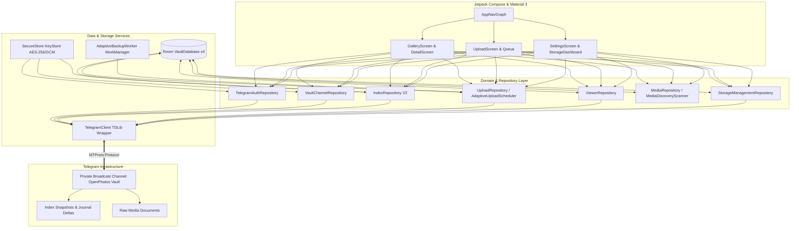

# OpenPhotos — Telegram-Backed Photo Vault & Unified Media Gallery

> **Free, open-source Android application providing a seamless, Google-Photos-style unified gallery and automated backup, backed entirely by your personal Telegram account.**

[](LICENSE)
[-brightgreen)](https://developer.android.com)
[-green)](https://developer.android.com)

---

## 🔒 Security & Storage Disclosures

> [!IMPORTANT]
> **On-Device Security & Hardware Encryption:**
> All sensitive local credentials (`api_id`, `api_hash`, phone number, and TDLib database keys) are encrypted on-device using **AES-256 in GCM mode** via keys generated inside the hardware-backed **Android KeyStore** (`SecureStore`).
>
> **Telegram Vault Storage Model:**
> Media files are stored in a dedicated private broadcast channel (`OpenPhotos Vault` / `vault-marker:openphotos-v1`) under your own Telegram account as raw, full-quality Documents.
> - **Transport Security:** Transmitted over Telegram's native **MTProto encryption**.
> - **Storage Model:** Media resides in Telegram's cloud storage. While isolated to your private channel, files are protected by Telegram's server-side storage security and your account's 2FA credentials. *This is not end-to-end zero-knowledge client-side encryption.*

---

## 🌟 Key Features (V2 Architecture)

- **Unified Local & Cloud Gallery Stream:** Displays device photos/videos and Telegram cloud media in a single seamless, chronological grid with visual status badges (`LOCAL_ONLY`, `PENDING_BACKUP`, `UPLOADING`, `BACKED_UP`, `REMOTE_ONLY`).
- **Automated MediaStore Discovery Scanner:** Automatically scans and indexes device media using lightweight queries (dimensions, durations, dates, file sizes) without loading heavy files or computing hashes upfront.
- **Real-Time ContentObserver:** Detects newly captured camera roll photos and videos instantly and schedules continuous backups.
- **Smart Priority Queue (`P0`–`P4`) & Anti-Starvation:**
  - `P0`: User-selected manual uploads.
  - `P1`: Newly created camera roll media (uploaded first).
  - `P2`: Recent existing media (< 30 days).
  - `P3`: Older existing media (> 30 days).
  - `P4`: Large videos ($\ge 500\text{ MB}$) or deferred media.
  - *Anti-Starvation:* Incrementally boosts queued age weights so older media is never starved.
- **Adaptive Upload Scheduler & MTProto 429 Resilience:** Executes 1 active document upload at a time to prevent rate limits. Automatically catches MTProto `FLOOD_WAIT_X` responses, persists `nextAttemptTimestamp`, and surfaces live countdown banners.
- **Telegram Vault Index V2 (Snapshots & Deltas):** Replaces monolithic JSON document rewrites with lightweight incremental journal deltas (`openphotos_journal_<seq>.json`) and periodic snapshot compaction (`openphotos_index_v2.json`).
- **Orphaned Upload Recovery Scanner:** Automatically detects and recovers untracked Telegram document uploads if network writes are interrupted.
- **Full-Resolution On-Demand Detail Viewer:** Pinch-to-zoom, double-tap zoom (1x $\leftrightarrow$ 2.5x), video playback, real-time download progress, and Scoped Storage MediaStore gallery export.
- **Independent Storage Management & Free Up Space:**
  - Three distinct deletion actions: *Delete Device Copy*, *Delete Cloud Copy*, *Delete Everywhere*.
  - *Free Up Space:* Verifies cloud backups and recovers local disk space without deleting cloud copies.
  - Storage Dashboard displaying local/cloud counts, thumbnail cache sizes, and recoverable storage metrics.
- **User Curation & Albums:** Create, rename, delete albums and manage multi-album memberships independently without duplicating media files.

---

## 🏗️ Architecture & System Blueprint



---

## 📥 Build & Setup Instructions

### Prerequisites
- **Android Studio Ladybug / JDK 17+**
- **Android SDK:** Compile SDK 35, Min SDK 26 (Android 8.0+)
- **Telegram API Credentials:** Obtain a free `api_id` and `api_hash` from [my.telegram.org](https://my.telegram.org).

### Build Commands

1. **Clone the repository:**
   ```bash
   git clone https://github.com/Yadavallitejas/open-photos.git
   cd open-photos
   ```

2. **Build Debug APK:**
   ```bash
   ./gradlew app:assembleDebug
   ```

3. **Run Unit Test Suite:**
   ```bash
   ./gradlew testDebugUnitTest
   ```

4. **Install to Device:**
   ```bash
   ./gradlew app:installDebug
   ```

---

## 📄 License

Distributed under the **Apache License 2.0**. See [`LICENSE`](LICENSE) for details.
